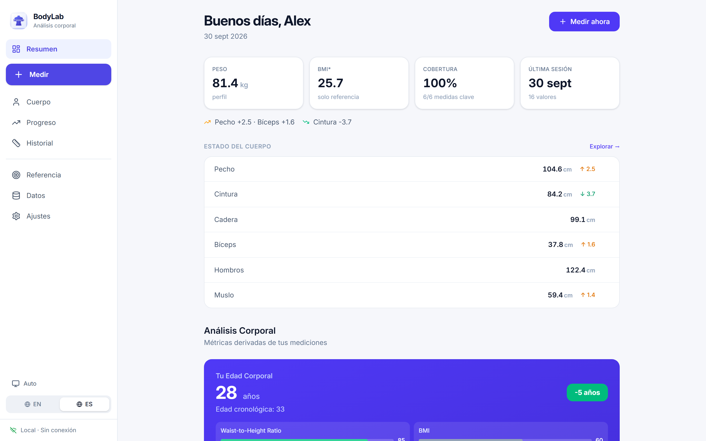
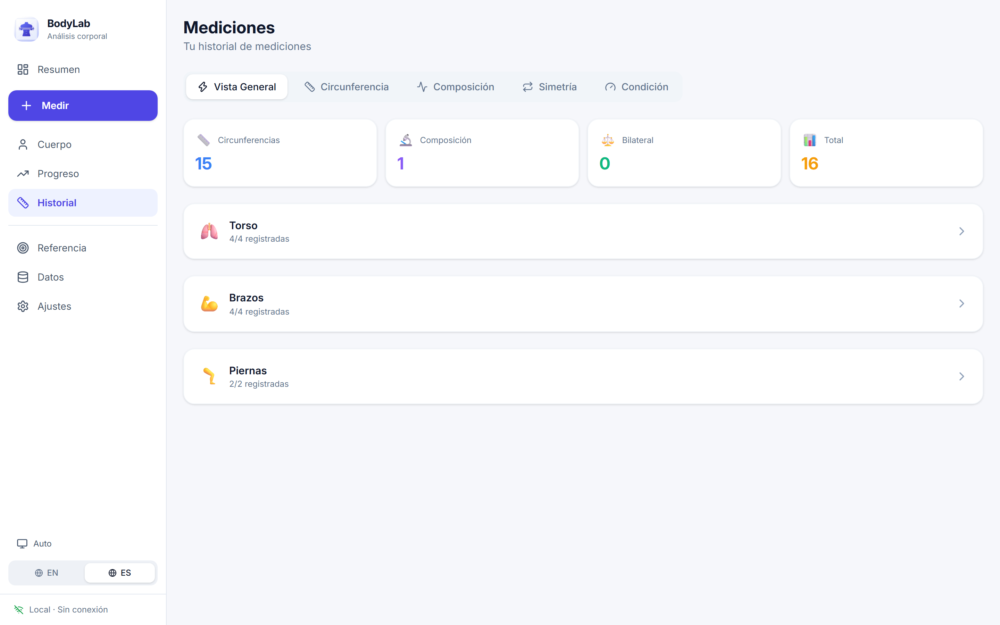
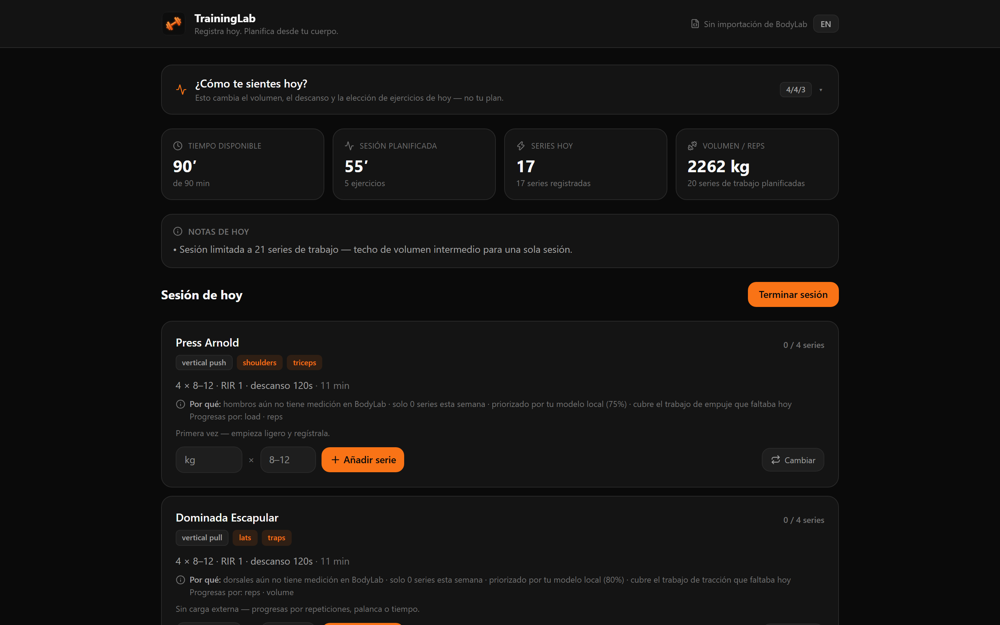
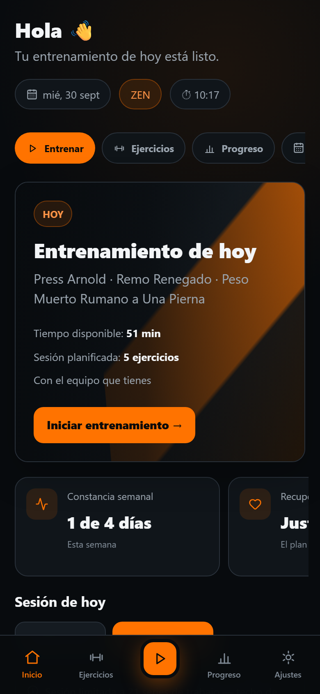

# Fitness — BodyLab + TrainingLab

> Dos aplicaciones locales, sin cuenta y sin servidores, para **medir tu cuerpo** y **entrenar con un plan que se deriva de esas medidas**.
>
> *Two local, account-free apps: measure your body (BodyLab) and train from a plan derived from those measurements. Offline-first, data stays on your device.*

[](https://github.com/SCP-00/Fitness/releases)
[](fitness-ecosystem/docs/TESTING.md)
[](fitness-ecosystem/LICENSE)
[](#-descargar)

---

## Mi rol en el proyecto

**ES.** Producto propio: la idea, el alcance y las decisiones de diseño son míos, igual que el criterio de calidad. Lo que aporta el proyecto no es una pantalla bonita, sino la cadena completa *medir → analizar → planificar → registrar → volver a medir*, con un contrato de datos versionado entre las dos aplicaciones para que el plan cambie cuando cambian tus medidas.

- **Definí el contrato de exportación** (`bodylab-traininglab-link`, v2): perfil, medidas, puntos débiles por segmento y récords. Sin él, las dos apps serían dos apps sueltas.
- **Definí los protocolos y las fórmulas** que el motor calcula, con su error declarado (SEE) en lugar de un número sin contexto.
- **Definí la privacidad como requisito**, no como extra: sin cuentas, sin telemetría, sin nube. Todo vive en IndexedDB o en un SQLite local.
- **Criterio de calidad:** 847 pruebas del núcleo + 110 de la web, más E2E de navegador y humo del binario de escritorio.

**EN.** Self-directed product: the idea, the scope and the design decisions are mine, and so is the quality bar. The value is not the UI but the full *measure → analyse → plan → log → measure again* loop, tied together by a versioned data contract between both apps.

## Cómo se ve

| BodyLab — Resumen | BodyLab — Historial |
|---|---|
|  |  |
| **TrainingLab — Sesión de hoy** | **Móvil (misma app, misma URL)** |
|  |  |

*Las capturas se generan desde el bundle compilado (`node scripts/capture-screenshots.mjs`), no se toman a mano: si la app cambia, se vuelven a hacer con un comando en lugar de quedarse desactualizadas.*

## Descargar

Windows 10/11 · instalador NSIS · ~4–18 MB · sin dependencias, sin cuenta, funciona sin internet.

| Aplicación | Descarga directa | Qué es |
|---|---|---|
| **BodyLab** | **[⬇ BodyLab-setup.exe](https://github.com/SCP-00/Fitness/releases/latest/download/BodyLab-setup.exe)** | Antropometría, análisis corporal, mapa muscular 2D, educación de ejercicios |
| **TrainingLab** | **[⬇ TrainingLab-setup.exe](https://github.com/SCP-00/Fitness/releases/latest/download/TrainingLab-setup.exe)** | La sesión de hoy: tiempo, equipamiento, registro de series, descansos |

Los dos enlaces apuntan siempre a la última versión publicada. Historial completo en [Releases](https://github.com/SCP-00/Fitness/releases).

> **Aviso de Windows:** los instaladores no están firmados con certificado de código (cuesta dinero y esto es un proyecto personal). SmartScreen mostrará "Windows protegió tu PC" la primera vez: pulsa **Más información → Ejecutar de todas formas**.

### Probar en el navegador (sin instalar)

| | |
|---|---|
| **BodyLab** | <https://scp-00.github.io/Fitness/bodylab/> |
| **TrainingLab** | <https://scp-00.github.io/Fitness/traininglab/> |

Funcionan igual que el escritorio: todo ocurre en tu navegador y los datos viven en su IndexedDB local.

## Qué hace cada mitad

### BodyLab — la mitad científica

- **Antropometría** con protocolos explicados: perímetros, pliegues cutáneos (Jackson-Pollock 3), cinta Navy, Cooper de 12 min, frecuencia cardíaca en reposo.
- **Análisis matemático** del estado corporal para hombres y mujeres: McCallum, Venus, Adonis, somatotipo, WHtR, índice de simetría y composición estimada con su error declarado (SEE).
- **Mapa muscular 2D** del cuerpo a partir de tus medidas, con puntuación por grupo y panel de simetría.
- **Educación**: mecánica del ejercicio, tipo de movimiento, qué músculo trabaja, cómo progresar y qué medición lo mide.
- **Progreso**: evolución temporal, comparación de instantáneas, edad corporal, riesgo de salud y correlaciones.
- **La edad se deriva de la fecha de nacimiento** cada vez que se muestra; nunca se guarda un número que envejezca mal.

### TrainingLab — la mitad que se entrena

- **Pantalla "Hoy"**: una sesión planificada para el tiempo que tienes (90 minutos por defecto, nunca se pasa).
- **Readiness**: energía, motivación y agujetas del día modulan la sesión.
- **Tu equipamiento real**: declaras lo que tienes y el planificador no propone nada que no puedas hacer.
- **Registro con teclado**: series, peso, repeticiones, RIR, cronómetro de descanso, notas.
- **Récords**: Epley redondeado igual que en BodyLab, con aviso visual y sonido al superar un PR.
- **Cues de sonido sintetizados** con Web Audio, sin archivos de audio.
- **IA local en tres niveles**: reglas deterministas, un modelo pequeño entrenado con tu propio historial que explica sus elecciones, y —opcional— un LLM local (llama.cpp / LM Studio / Ollama / Jan) que propone y cuya propuesta pasa por la aritmética. Todo en tu equipo.

### El ecosistema: medir → entrenar → volver a medir

BodyLab exporta un archivo de enlace (`bodylab-traininglab-link`, contrato **v2**) con tu perfil, tus medidas, tus **puntos débiles** por segmento y tus récords. TrainingLab lo importa y planifica contra él: prioriza lo que no entrenas y lo que se queda atrás. Vuelves a medirte, exportas otra vez, y el plan se recalcula.

## Uso en familia por LAN (opcional)

Sin servidor no hay nada compartido: cada dispositivo tiene sus datos. Si quieres el mismo historial en la red de casa:

```bash
pnpm lan --shared   # sirve ambas apps para la LAN + historial compartido
```

- Guarda miembros, sesiones, series y registros de salud en un único archivo SQLite (`node:sqlite`, sin dependencias externas).
- **Login no estricto**: en la LAN basta con escribir tu nombre para reclamar tu historial; en la web y el escritorio no hay login porque la app es local.
- El historial compartido se sirve en claro dentro de tu red: está escrito en la interfaz, porque no es privado. Úsalo solo en una red de confianza.

## Privacidad

- Sin cuentas, sin telemetría, sin analítica, sin nube. Ningún punto del código envía datos a ningún sitio.
- Tus medidas y tus series viven en el IndexedDB de tu navegador o del webview de escritorio. Copia de seguridad por exportación JSON/CSV.
- La única conexión posible es la que tú abras: tu servidor LAN o tu servidor LLM en `127.0.0.1`.
- La comprobación de actualizaciones del escritorio es manual y opcional (Ajustes, Tauri updater). Nada se descarga solo.

## Estado

- **BodyLab**: `1.0.0-beta.6` — funcional y de uso diario; pulido de UI y accesibilidad en curso.
- **TrainingLab**: `0.2.0` — cinco pantallas (Inicio · Ejercicios · Entrenamiento/ZEN · Progreso · Ajustes), mapa corporal 2D de doble lente, reps configurables, plan, registro, descansos, récords, sonidos, notificaciones e historial compartido.
- **Calidad:** 847 pruebas del núcleo + 110 de la web + E2E de navegador y humo del binario. `pnpm check` corre la pirámide completa.

Detalle de lo hecho y lo pendiente: [`ROADMAP.md`](ROADMAP.md) y [`fitness-ecosystem/CHANGELOG.md`](fitness-ecosystem/CHANGELOG.md).

<details>
<summary><strong>Para desarrolladores</strong> (arranque, arquitectura, convenciones)</summary>

### Arranque

```bash
pnpm install   # Node >= 20, pnpm >= 11
pnpm dev       # BodyLab web → http://localhost:5173
pnpm lan       # ambas apps para la LAN + hub → http://localhost:8090
pnpm test      # suites del núcleo
pnpm check     # typecheck + núcleo + web + E2E
```

Todo se ejecuta **desde `fitness-ecosystem/`**, que es el monorepo real:

```
fitness-ecosystem/
├── bodylab/
│   ├── core/            # motor puro en TypeScript, cero UI/DOM
│   ├── integrations/    # musclemapjs (mapa 2D), clad-body (ISO 8559-1)
│   ├── packages/contracts
│   └── apps/{web,desktop}
├── traininglab/apps/desktop   # Vite + React + Tauri 2
├── scripts/                   # serve-lan, lan-store/lan-api (SQLite), iconos, capturas
├── tests/
└── docs/
```

### Escritorio

```bash
cd bodylab/apps/desktop && pnpm dev        # BodyLab en ventana nativa
cd traininglab/apps/desktop && pnpm dev    # TrainingLab en ventana nativa
```

Requiere Rust estable y Visual Studio Build Tools (C++), una sola vez. `pnpm build` genera el instalador NSIS.

### Convenciones que se cumplen en todo el repo

- El núcleo es TypeScript puro: **nunca** importa React, Three, Tauri ni el DOM.
- Los números escritos por el usuario pasan por `parseNumberInput` (coma decimal incluida).
- Identificadores y comentarios en inglés; la interfaz en español e inglés.
- Los alias `@fitness/bodylab-*` se declaran en seis archivos a la vez; `database` es la única excepción.
- Los workflows viven en `.github/workflows/` en la raíz del repositorio.

Detalles en [`AGENTS.md`](AGENTS.md) y [`fitness-ecosystem/docs/ARCHITECTURE.md`](fitness-ecosystem/docs/ARCHITECTURE.md).
</details>

## Licencia y créditos

- Código: **Apache-2.0** — [`fitness-ecosystem/LICENSE`](fitness-ecosystem/LICENSE).
- Contenido anatómico derivado de **Z-Anatomy**, bajo **CC BY-SA 4.0**: si redistribuyes esos assets, mantén la licencia y la atribución.
- Librerías de terceros: [`THIRD_PARTY_NOTICES.md`](fitness-ecosystem/THIRD_PARTY_NOTICES.md).

Hecho por [SCP-00](https://github.com/SCP-00).
